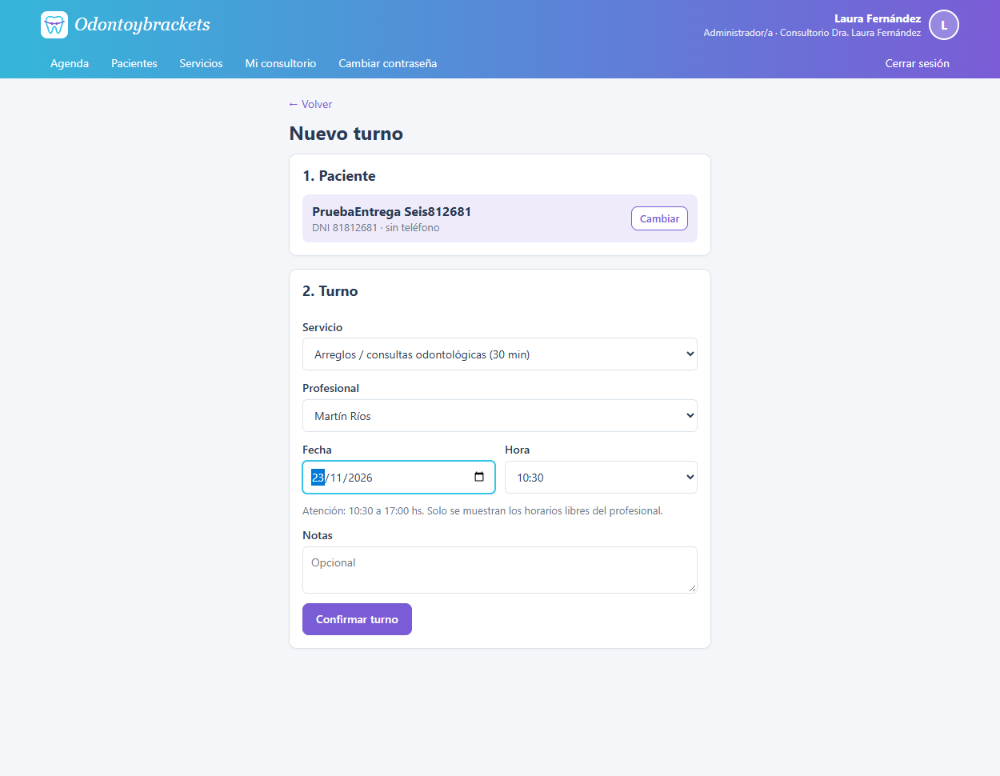
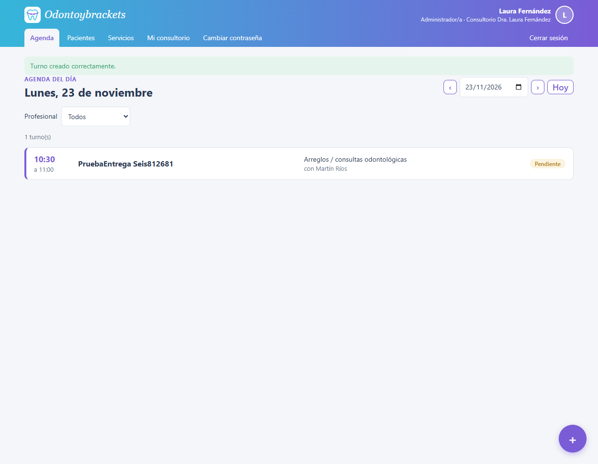
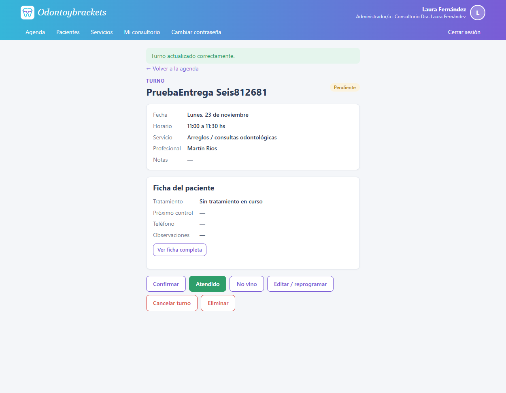

# Odontoybrackets

**SaaS — Parte 6**  
**Desarrollo de la función principal**

Sofía Aguilar  
Sebastián López

Repositorio: [github.com/sobas2785/Odontoybrackets](https://github.com/sobas2785/Odontoybrackets)

Noviembre de 2026

## Introducción

Odontoybrackets es un SaaS de gestión de turnos y pacientes para consultorios odontológicos, especialmente de ortodoncia. En esta entrega se revisó el alcance del MVP y se probó en Chrome, contra Supabase, el registro, la consulta y la reprogramación de un turno con datos ficticios.

## Problema identificado y cliente ideal

Coordinar controles y turnos con planillas, mensajes o anotaciones dispersas dificulta consultar la agenda, detectar superposiciones y recuperar los datos de cada paciente. El cliente ideal es un consultorio odontológico pequeño, con uno o más profesionales y, cuando corresponde, una persona de recepción. En ortodoncia es habitual coordinar controles periódicos.

## MVP y modelo de datos

El MVP reúne la agenda diaria, la búsqueda y el alta de pacientes, el registro y la consulta de turnos y la configuración básica de servicios y horarios. Los perfiles representan a los usuarios del consultorio y distinguen administración, profesionales y recepción. Cada turno relaciona un consultorio, un paciente, un servicio y el perfil que atiende. Guarda fecha, inicio, fin, estado y creador. Los tratamientos forman parte de la ficha del paciente y aportan contexto para los controles. El modelo completo y su DER se encuentran en [Modelo de datos](modelo-de-datos.md).

## Historias de usuario

- Como recepcionista, quiero buscar un paciente por nombre o DNI para usar su ficha y evitar duplicados.
- Como recepcionista, quiero dar de alta a un paciente desde el turno si no encuentro su ficha.
- Como integrante del consultorio, quiero ver horarios disponibles según fecha, servicio y profesional para evitar superposiciones.
- Como profesional, quiero consultar la agenda y abrir un turno para ver a quién atiendo, a qué hora y por qué motivo.
- Como integrante del consultorio, quiero reprogramar un turno y recibir una confirmación visible para saber que se guardó.
- Como administrador, quiero que los datos pertenezcan a mi organización y estén separados de los de otros consultorios.

## Función principal y recorrido

La función principal es **Registrar y gestionar un turno**.

1. Ingresar con el correo y la contraseña del consultorio. La aplicación abre la agenda.
2. Elegir el día en la agenda y abrir «Nuevo turno».
3. Buscar al paciente por nombre, apellido o DNI. Si existe, seleccionarlo. Si falta, abrir «Paciente nuevo», completar los datos requeridos y guardar.
4. Elegir el servicio y el profesional. Confirmar la fecha y seleccionar uno de los horarios libres. Las notas son opcionales.
5. Presionar «Confirmar turno». La aplicación vuelve a la agenda del día reservado y muestra «Turno creado correctamente».
6. Ubicar la reserva en el listado y abrirla para consultar paciente, fecha, horario, servicio, profesional y estado.
7. Para reprogramar un turno pendiente o confirmado, abrir «Editar / reprogramar», elegir el nuevo horario y guardar. El detalle muestra «Turno actualizado correctamente».

## Navegación, formularios y consultas

Vue Router usa /login para el ingreso y protege /agenda, /turnos/nuevo, /turnos/:id y /turnos/:id/editar mediante una guarda de sesión. La agenda carga los turnos del día elegido y permite filtrar por profesional cuando hay más de uno. El formulario de turnos se comparte entre alta y edición e incluye un buscador y un formulario breve de pacientes. El detalle consulta el turno por identificador y enlaza a la ficha del paciente.

La aplicación consulta las tablas de Supabase desde sus servicios. La agenda filtra por fecha y ordena por hora de inicio. El detalle recupera por ID los datos relacionados del paciente, el servicio y el profesional. Crear y editar usan la misma preparación de datos, con INSERT para el alta y UPDATE por ID para la edición. Ambas operaciones solicitan el registro guardado antes de navegar. PostgreSQL calcula el fin a partir de la duración del servicio cuando se envía vacío.

## Validaciones y mensajes

El formulario requiere paciente, servicio, profesional, fecha y hora. El alta de pacientes requiere nombre y apellido. Si se informa un DNI, el formulario exige siete u ocho dígitos. La ficha completa valida el formato del correo con el control del navegador y limita la fecha de nacimiento al día actual. PostgreSQL comprueba el formato del DNI y su unicidad por consultorio.

El formulario recalcula la disponibilidad al cambiar fecha, servicio o profesional. Alta y edición verifican la hora contra las opciones disponibles. Como excepción, al editar se puede conservar el horario histórico si se mantienen fecha, servicio y profesional. La consulta de disponibilidad excluye el propio turno editado. El esquema valida las referencias al mismo consultorio, el día y horario al crear o al cambiar la franja, la secuencia de horas y la superposición por profesional. Al guardar, los avisos de éxito se muestran en la agenda o el detalle. Los fallos se muestran en el formulario. El traductor de errores contempla DNI duplicado, superposición y permisos.

## Vinculación al consultorio y seguridad

Supabase Auth identifica a la persona que inicia sesión. El esquema deriva el consultorio del perfil activo, completa consultorio_id por defecto y asigna creado_por al usuario autenticado al registrar un turno. Las políticas Row Level Security de PostgreSQL limitan las lecturas y escrituras de turnos al consultorio de la sesión. La eliminación física requiere rol de administración. El trigger de turnos comprueba que el paciente, el servicio y el profesional pertenezcan al mismo consultorio. La guarda de Vue Router dirige a la pantalla de ingreso cuando falta una sesión.

## Pruebas con datos ficticios

Se utilizó Chrome con la aplicación local y el proyecto de Supabase configurado. Los controles de superposición, vínculo al consultorio, permisos y aislamiento se observaron mediante las respuestas de la API autenticada. Se verificó la limpieza del turno y del paciente creados para la prueba.

| Prueba | Datos utilizados | Resultado esperado | Resultado obtenido | Estado |
| --- | --- | --- | --- | --- |
| Compilación inicial y final | npm ci y npm run build | Generar la aplicación | Vite completó ambas compilaciones | Aprobada |
| Ruta privada sin sesión | /turnos/nuevo en sesión nueva | Redirigir al ingreso | Chrome llegó a /login | Aprobada |
| Ingreso y agenda | Cuenta ficticia de Laura | Abrir /agenda | Chrome abrió la agenda | Aprobada |
| Búsqueda de paciente | DNI ficticio 40111222 | Mostrar coincidencia | El buscador devolvió un paciente | Aprobada |
| Campo obligatorio vacío | Nombre vacío en alta rápida | Impedir el envío | El navegador marcó el campo obligatorio | Aprobada |
| Turno incompleto | Servicio sin elegir | Impedir el envío | El navegador marcó el servicio obligatorio | Aprobada |
| Nacimiento futuro | 01/01/2027 en la ficha | Marcar la fecha fuera de rango | El navegador detectó que superaba el máximo | Aprobada |
| Formato de correo | correo-invalido en la ficha | Marcar el formato inválido | El navegador detectó el formato inválido | Aprobada |
| Formato de DNI | abc1234 | Impedir el envío | El navegador marcó el formato inválido | Aprobada |
| DNI repetido | DNI ficticio 40111222 | Rechazar el alta duplicada | Se mostró el mensaje de DNI existente | Aprobada |
| Alta de paciente | PruebaEntrega Seis812681 | Crear y seleccionar al paciente | Se guardó y quedó seleccionado en el turno | Aprobada |
| Día sin atención | Domingo 22/11/2026 | Mostrar aviso y deshabilitar hora | Se mostraron el aviso y el selector deshabilitado | Aprobada |
| Alta y consulta en agenda | Lunes 23/11/2026, 10:30 | Guardar, confirmar y listar | La agenda mostró el aviso y la reserva | Aprobada |
| Detalle | ID del turno de prueba | Abrir el detalle de la reserva | Chrome abrió la vista del turno | Aprobada |
| Reprogramación | Mismo turno, 11:00 | Guardar y confirmar en el detalle | Se mostró «Turno actualizado correctamente» | Aprobada |
| Consultorio y autor | Reserva nueva de Laura | Asociar organización y creador | La respuesta devolvió ambos valores esperados | Aprobada |
| Superposición por API | Mismo profesional, fecha y hora | Rechazar el segundo turno | PostgreSQL devolvió 23P01 | Aprobada |
| Aislamiento por API | Cuenta de Pablo e ID del turno de Laura | Ocultar el turno ajeno | La consulta devolvió cero filas | Aprobada |
| Permiso de eliminación por API | Cuenta de Carla, rol recepción | Impedir la baja física | La operación afectó cero filas | Aprobada |
| Limpieza de datos ficticios | IDs del turno y del paciente | Retirar ambos registros creados | Cada eliminación devolvió una fila | Aprobada |

## Alcance de la verificación

La superposición se comprobó con una inserción duplicada mediante la API. Queda pendiente simular dos sesiones que elijan simultáneamente el mismo horario y verificar el aviso en pantalla. El permiso de baja se comprobó mediante la API, que filtró la fila, y queda pendiente provocar un error visible de permisos en la interfaz. El esquema versionado no contiene para tratamientos una comprobación de pertenencia de las referencias equivalente al trigger de turnos. Su revisión queda fuera de este recorrido. No se ejecutaron los scripts de reconstrucción o de datos de prueba.

## Conclusión

El recorrido verificado permite registrar un turno para un paciente nuevo, consultar el resultado en la agenda y en el detalle, y reprogramarlo con confirmación visible. La prueba contra Supabase acreditó el vínculo al consultorio y al creador, el rechazo de una reserva superpuesta y la separación entre las dos organizaciones ficticias utilizadas.

## Capturas del recorrido

**Figura 1.** Formulario de alta con paciente, servicio, profesional, fecha y hora.

**Figura 2.** Agenda del 23 de noviembre con el turno guardado y la confirmación de alta.

**Figura 3.** Detalle a las 11:00 y confirmación de reprogramación.

