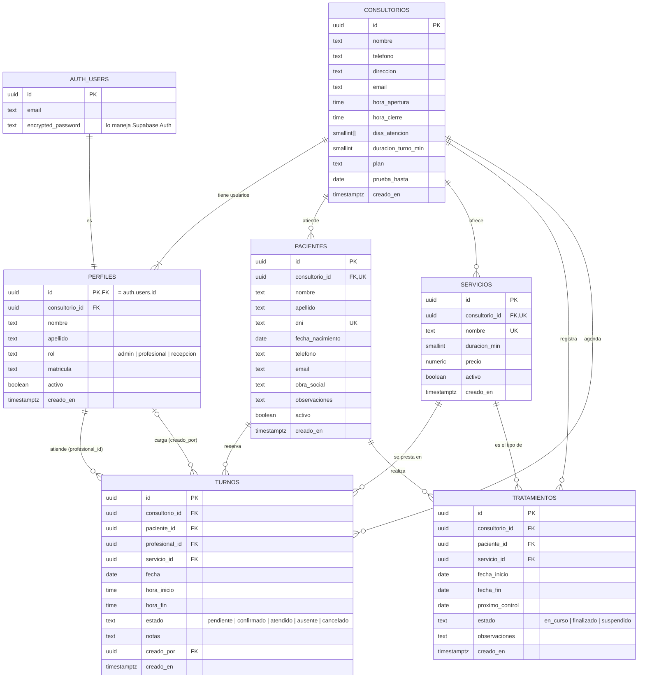

# Modelo de datos — Odontoybrackets

Base de datos: **PostgreSQL gestionado por Supabase**.
Script para reconstruir la estructura: [`supabase/schema.sql`](../supabase/schema.sql).
Datos de prueba: [`supabase/seed.sql`](../supabase/seed.sql).
Detalle de cada campo: [diccionario de datos](diccionario-de-datos.md).

---

## 1. Qué información necesita guardar la función principal

La función principal del MVP es la **gestión de turnos** del consultorio. Para dar,
mostrar y seguir un turno el sistema necesita saber:

| Pregunta | Dato que hay que guardar |
|---|---|
| ¿De qué consultorio es el turno? | El **consultorio** (cada cliente del SaaS tiene su propia agenda) |
| ¿Quién viene? | El **paciente**, con sus datos de contacto para confirmar o recordar el turno |
| ¿Quién lo atiende? | El **profesional** (odontólogo/a) que es usuario del sistema |
| ¿Qué se le hace? | El **servicio** (limpieza, control de ortodoncia, etc.) y cuánto dura |
| ¿Cuándo? | **Fecha, hora de inicio y hora de fin** (según la duración del servicio) |
| ¿Qué pasó con el turno? | El **estado**: pendiente, confirmado, atendido, ausente o cancelado |
| ¿En qué etapa del tratamiento está el paciente? | El **tratamiento** en curso y la fecha del **próximo control** |
| ¿Cuándo atiende el consultorio? | **Días y horario de atención**, para no dar turnos fuera de horario |

---

## 2. Entidades (tablas)

| Tabla | Qué representa | Datos principales |
|---|---|---|
| `consultorios` | El **cliente que contrata el SaaS** (la organización). Todo lo demás le pertenece. | nombre, contacto, horario y días de atención, duración de cada turno, plan y fin de la prueba gratis |
| `perfiles` | Un **usuario del sistema** (odontólogo/a o recepción). Extiende al usuario de Supabase Auth. | consultorio, nombre, apellido, rol, matrícula, activo |
| `pacientes` | Una persona que se atiende en un consultorio. | nombre, apellido, DNI, nacimiento, teléfono, email, obra social, observaciones, activo |
| `servicios` | Una **prestación** que ofrece el consultorio. | nombre, duración en minutos, precio de referencia, activo |
| `tratamientos` | Un **tratamiento largo** de un paciente (ej. ortodoncia con controles mensuales). | paciente, tipo (servicio), inicio, fin, próximo control, estado, observaciones |
| `turnos` | La **reserva** de un horario: une paciente, profesional y servicio en una fecha. | paciente, profesional, servicio, fecha, hora de inicio y fin, estado, notas, quién lo cargó |

Las contraseñas **no** están en ninguna de estas tablas: las guarda y valida
**Supabase Auth** en su tabla interna `auth.users` (ver punto 5).

---

## 3. Diagrama entidad-relación

> GitHub muestra este diagrama como imagen automáticamente. También está como
> imagen en [`der.png`](der.png) (para pegar en el informe).
> PK = clave primaria · FK = clave foránea · UK = forma parte de una clave única.



### Relaciones y cardinalidades

| Relación | Cardinalidad | Clave foránea | Al borrar el "padre" |
|---|---|---|---|
| Usuario de Auth → perfil | 1 a 1 | `perfiles.id` → `auth.users.id` | se borra el perfil |
| Consultorio → perfiles | 1 a N (al menos 1, el admin) | `perfiles.consultorio_id` | se borran |
| Consultorio → pacientes | 1 a N | `pacientes.consultorio_id` | se borran |
| Consultorio → servicios | 1 a N | `servicios.consultorio_id` | se borran |
| Consultorio → tratamientos | 1 a N | `tratamientos.consultorio_id` | se borran |
| Consultorio → turnos | 1 a N | `turnos.consultorio_id` | se borran |
| Paciente → turnos | 1 a N | `turnos.paciente_id` | **no se permite** (se da de baja al paciente) |
| Paciente → tratamientos | 1 a N | `tratamientos.paciente_id` | se borran |
| Servicio → turnos | 1 a N | `turnos.servicio_id` | **no se permite** (se desactiva el servicio) |
| Servicio → tratamientos | 1 a N | `tratamientos.servicio_id` | **no se permite** |
| Perfil (profesional) → turnos que atiende | 1 a N | `turnos.profesional_id` | **no se permite** (se desactiva el usuario) |
| Perfil → turnos que cargó | 0..1 a N | `turnos.creado_por` | queda en blanco |

Los turnos funcionan como una **tabla intermedia** entre pacientes, profesionales y
servicios: un paciente puede tener muchos turnos y un servicio se presta en muchos
turnos.

---

## 4. Cómo se representa a cada consultorio (multi-tenant)

Todos los consultorios comparten las mismas tablas. Para separar los datos de cada
cliente:

1. **Cada cliente es una fila de `consultorios`.**
2. **Todas las tablas con datos del negocio tienen `consultorio_id`**: pacientes,
   servicios, tratamientos y turnos. Así cada registro queda asociado a su cuenta.
3. **Cada usuario pertenece a un consultorio** a través de `perfiles.consultorio_id`.
4. **Row Level Security (RLS)** filtra todo automáticamente. La función
   `mi_consultorio_id()` devuelve el consultorio del usuario conectado y cada
   política compara contra ella:

   ```sql
   create policy "Miembros ven los pacientes"
     on public.pacientes for select to authenticated
     using (consultorio_id = (select public.mi_consultorio_id()));
   ```

   Es el mismo mecanismo que vimos en clase con `usuario_id = auth.uid()`, pero
   por consultorio en lugar de por usuario. Así varias personas del mismo
   consultorio comparten la agenda (necesario para el plan Empresa).
5. **`consultorio_id` se completa solo**: la columna tiene
   `default public.mi_consultorio_id()`, igual que en clase `usuario_id` tenía
   `default auth.uid()`. La aplicación nunca lo envía.
6. **No se pueden mezclar consultorios**: el trigger `validar_turno` verifica que
   el paciente, el servicio y el profesional de un turno sean del mismo consultorio
   del turno.

En los datos de prueba, *Juan Pérez* (mismo DNI) es paciente de los dos
consultorios: cada uno tiene su propia ficha y ninguno ve la del otro.

---

## 5. Usuarios y roles

**Datos que se guardan del usuario**

| Dónde | Qué |
|---|---|
| `auth.users` (Supabase Auth) | email, contraseña **encriptada**, confirmación del correo, último ingreso. La app no la maneja directamente: usa `signUp`, `signInWithPassword`, `updateUser` y `signOut`. |
| `perfiles` (nuestra tabla) | consultorio al que pertenece, nombre, apellido, rol, matrícula, activo |

**Alta de usuarios**: al registrarse desde la app, el trigger
`al_crear_usuario` crea automáticamente un **consultorio nuevo** con el nombre
escrito en el formulario, le carga los 10 servicios base y deja al usuario como
**admin**. Para sumar a alguien a un consultorio existente se indica en
`raw_app_meta_data`, que solo se puede escribir desde el servidor; así nadie puede
"colarse" en un consultorio ajeno desde el navegador.

**Roles**

| Permiso | admin | profesional | recepcion |
|---|:---:|:---:|:---:|
| Ver agenda, pacientes, servicios y tratamientos | ✅ | ✅ | ✅ |
| Dar, editar, reprogramar y cancelar turnos | ✅ | ✅ | ✅ |
| Cargar y editar pacientes (y darlos de baja) | ✅ | ✅ | ✅ |
| Cargar y editar tratamientos (próximo control) | ✅ | ✅ | ❌ |
| Ser asignado como profesional de un turno | ✅ | ✅ | ❌ |
| ABM de servicios | ✅ | ❌ | ❌ |
| Editar datos y horario del consultorio | ✅ | ❌ | ❌ |
| Eliminar definitivamente pacientes o turnos | ✅ | ❌ | ❌ |
| Cambiar el plan o su propio rol | ❌ | ❌ | ❌ |

Los permisos se controlan **en la base** (políticas RLS y permisos por columna),
no solo ocultando botones: aunque alguien manipule el navegador, la base rechaza
la operación.

---

## 6. Reglas que asegura la base de datos

| Regla | Cómo |
|---|---|
| Un profesional no puede tener dos turnos superpuestos | Restricción `turnos_sin_superposicion` (`exclude using gist` sobre el rango horario). Los turnos cancelados o ausentes liberan el horario. |
| Solo se dan turnos los días y en el horario de atención | Trigger `validar_turno` (usa `dias_atencion`, `hora_apertura` y `hora_cierre` del consultorio) |
| La hora de fin sale de la duración del servicio | Trigger `validar_turno` la calcula si llega vacía |
| DNI sin repetir dentro del consultorio | `unique (consultorio_id, dni)` |
| Servicios sin nombres repetidos en el consultorio | `unique (consultorio_id, nombre)` |
| Estados y roles válidos | `check (estado in (...))`, `check (rol in (...))` |
| Fechas y horarios coherentes | `check (hora_fin > hora_inicio)`, `check (hora_apertura < hora_cierre)`, `check (fecha_fin >= fecha_inicio)` |
| No se pierde historial | Pacientes y servicios se dan de baja con `activo = false`; un turno se cancela cambiando su estado |
| El cliente no puede cambiarse el plan | Permisos de `update` solo sobre las columnas editables de `consultorios` |

"Último turno" y "próximo turno" del paciente **no se guardan**: se calculan a
partir de la tabla `turnos`, así nunca quedan desactualizados.

---

## 7. Datos de prueba

`supabase/seed.sql` carga dos consultorios para comprobar las relaciones:

| | Consultorio Dra. Laura Fernández | Sonrisas Centro Odontológico |
|---|---|---|
| Horario | Lunes a viernes, 10:30 a 17:00 | Lunes a sábado, 9:00 a 13:00 |
| Plan | Profesional (en prueba) | Básico |
| Usuarios | Laura (admin), Martín (profesional), Carla (recepción) | Pablo (admin) |
| Pacientes | 5 (uno dado de baja) | 3 |
| Tratamientos | 3 | 1 |
| Turnos | 11 (hoy, historial y próximos) | 4 |

Al iniciar sesión con un usuario de cada consultorio se ve que cada uno accede
solamente a sus propios registros. Las cuentas y la contraseña de prueba están
en el encabezado de `seed.sql`.
